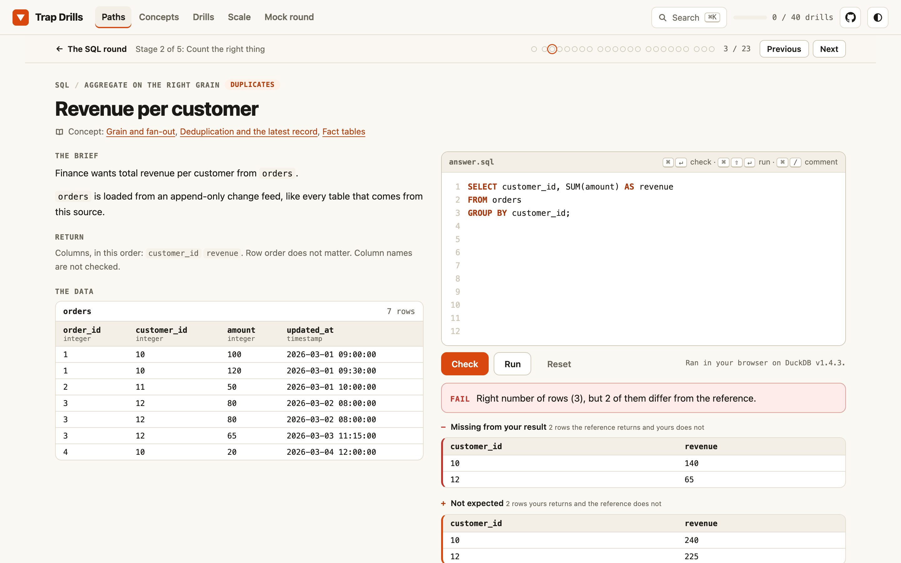

# Trap Drills

[](https://github.com/linusdominic/de-trap-drills/actions/workflows/ci.yml)

Data engineering drills where the obvious answer fails.

Each drill gives you a small dataset with a trap planted in it: a resent row, a NULL, a missing day, a tie, a time zone. You write the SQL or the Python, the checker runs it next to a reference answer, and you see exactly which rows came out wrong. There are 18 SQL and 8 Python drills, and they run in the browser or on the command line.

**[Try it in your browser](https://linusdominic.github.io/de-trap-drills/)**. There is nothing to install, and nothing you type leaves the page.



## Why

Most SQL practice checks your query against clean data, so `SUM(amount)` passes whether or not you thought about duplicates. Production tables are not clean, and neither are the datasets a good interviewer brings.

Every drill here ships with a *naive* answer, the one most people write first, and the test suite proves that it fails on the drill's data. The explanation that follows says why, and what to answer when the interviewer asks you to make it fast on a very large table.

## The traps

| Family | What goes wrong | Drills |
| --- | --- | --- |
| Duplicates | The table has more rows than the thing you are counting. | `dedupe-latest`, `sum-after-dedupe`, `login-streaks-duplicates` |
| Ties | Two rows share the value you rank by. | `top-n-ties`, `second-highest-ties` |
| Missing rows | A day, a month or a group has no rows, and the query quietly skips it. | `rolling-7d-missing-days`, `mom-growth-missing-month`, `cohort-retention-where-filter` |
| NULLs | A comparison with NULL is neither true nor false. | `not-in-null`, `reconcile-null-and-missing` |
| Grain | Rows are multiplied or mis-weighted before they are aggregated. | `fanout-join-sum`, `avg-of-averages` |
| Time | Boundaries, time zones and the order of events. | `sessionize-datediff`, `consecutive-months-year-boundary`, `funnel-event-order`, `local-day-boundary`, `between-timestamp-end`, `tumbling-windows-timezones` |
| History | The value that is true now is not the value that was true then. | `scd2-as-of-join`, `scd2-load-null-change` |
| Messy input | The file is not as clean as the example in the spec. | `flatten-json`, `slowest-endpoints-p95`, `reconcile-float-money`, `csv-quoted-commas` |
| Streams | The input is read once, arrives out of order, or never ends. | `latest-by-key-late-arrival`, `merge-sorted-streams` |

## Use it

### In the browser

Open the [site](https://linusdominic.github.io/de-trap-drills/). SQL runs in DuckDB-Wasm and Python in Pyodide, both downloaded from jsDelivr the first time you press Check. Progress and drafts are kept in your browser's local storage.

### On your machine

You need [uv](https://docs.astral.sh/uv/). It installs Python 3.12 and DuckDB for you.

```bash
git clone https://github.com/linusdominic/de-trap-drills
cd de-trap-drills
uv sync
uv run drills list
uv run drills show sum-after-dedupe     # the prompt and the data
uv run drills start sum-after-dedupe    # creates answers/sum-after-dedupe.sql
uv run drills check sum-after-dedupe    # runs it
```

A failed check looks like this:

```text
FAIL  Right number of rows (3), but 2 of them differ from the reference.
Missing from your result (2 rows, expected but not returned):
  customer_id  revenue
  -----------  -------
  10           140
  12           65
Not expected (2 rows, returned but wrong):
  customer_id  revenue
  -----------  -------
  10           240
  12           225

Stuck? drills check sum-after-dedupe --trap
```

Python answers run as ordinary Python on your machine, in a separate process with a 5-second limit. There is no sandbox, so only check code you wrote.

### With a coach

[CLAUDE.md](CLAUDE.md) turns a coding agent into a mock interviewer. Open the repository in the agent and say "quiz me on SQL". It picks a drill, waits for your answer, runs `drills check`, withholds the trap until you have tried, and then asks the scale follow-up.

For behavioural practice, copy [profile.example.md](profile.example.md) to `private/profile.md` and fill it in. `private/` and `answers/` are git-ignored.

## How an answer is checked

- **SQL.** Your query and the reference query each run on a fresh in-memory DuckDB loaded with the drill's data. The two results are compared as sets of rows, or in order when the drill asks for an order. Numbers are compared after rounding to 6 decimal places, so `130` and `130.0` match. Column names are not checked; column count and order are.
- **Python.** Your function and the reference function are called on each case, and their results are compared as JSON. Some cases pass an iterator instead of a list, and one passes a stream that never ends.
- **Same rules on both sides.** The browser and the command line use the same normalising SQL and the same Python runner source. `make browser-check` runs every reference and naive answer in headless Chrome and fails if a single row or verdict differs from the command line.

A drill is one TOML file: prompt, setup SQL or test cases, naive answer, reference answer, explanation. See [drills/sql/11-not-in-null.toml](drills/sql/11-not-in-null.toml) for a short one. To add a drill, copy a file, change it and run `uv run drills verify`: the reference must pass and the naive answer must fail.

## The scale follow-up, measured

Every senior SQL question ends with "now make it fast on 10 billion rows", and the standard answers are usually recited, not tested. [tools/scale_bench.py](tools/scale_bench.py) tests five of them on one machine. The variants in each group return the same answer unless marked.

<!-- scale:start -->
Run on 2026-11-26: 100,000,000 rows over 100 daily partitions (2.0 GB of Parquet), DuckDB 2.0.1, Apple M5, 10 cores, 16 GB. Median of 5 runs.

| Question | Query | Median | Against the first |
| --- | --- | ---: | --- |
| Count and sum the events of one day out of 100. | text formatting around the column | 417 ms | baseline |
|  | date_trunc around the column | 13 ms | 32x faster |
|  | half-open range on the raw column | 12 ms | 34x faster |
|  | filter on the partition column | 2.5 ms | 167x faster |
| Count the orders and sum their latest amounts (about 1.25 versions per order). | ROW_NUMBER ... rn = 1 over all history | 1.13 s | baseline |
|  | arg_max ... GROUP BY over all history | 1.04 s | 1.1x faster |
|  | ROW_NUMBER over the newest day only (a narrower question) | 11 ms | 99x faster |
| Revenue per user segment: events joined to a 2,000,000-row user table. | join, then aggregate | 421 ms | baseline |
|  | aggregate per user, then join | 545 ms | 1.3x slower |
| Revenue per day and city for the last 30 days. | from the raw events | 35 ms | baseline |
|  | from a daily summary table | 1.2 ms | 29x faster |
| Count and sum the events of a single user. | files ordered by time | 34 ms | baseline |
|  | a copy sorted by user_id | 9.4 ms | 3.6x faster |
<!-- scale:end -->

Three results differ from the textbook, which is the reason to measure:

- **A function around the filter column is not always a full scan.** `strftime(ts, ...) = '2026-02-19'` read every row. `date_trunc('day', ts) = ...` did not: the plan shows DuckDB pushed a plain range on `ts` into the scan, and it cost the same as writing the range by hand.
- **`ROW_NUMBER() ... rn = 1` and `arg_max ... GROUP BY` are the same query here.** Both plans contain a hash aggregate and no window operator. The real saving is to deduplicate only the newest partition.
- **Aggregating before the join was slower.** With a 2-million-row dimension, the join is cheap and the extra per-user aggregate is not. The usual advice is about cutting shuffled rows on a cluster, which a single machine does not have.

The queries, all five timings per query and each plan's operators are in [results/scale.json](results/scale.json). Reproduce with `make scale` (about 4 GB of scratch disk, deleted afterwards).


## The field guide

[guide/README.md](guide/README.md) holds notes for the rounds the drills do not cover by themselves: data modeling (a six-step approach and a worked example), data system design (a 45-minute framework, a table of concepts and three worked designs), Spark and warehouse questions, and operations. Each SQL pattern and trap in it links to the drill that exercises it.

## What was verified

On macOS, on 26 November 2026, unless stated.

- `uv run drills verify`: for all 26 drills, the reference answer passes and the naive answer fails.
- All 18 SQL reference answers parse with PostgreSQL's parser (pglast 8.9).
- The site was opened in Chrome at desktop width and at 375 px, in light and dark: a failed check, a passed check and the scale page were exercised by hand.
- `make check`: ruff, mypy in strict mode and 134 tests pass. The same checks passed in GitHub Actions on Ubuntu 24.04.
- The live site: all 26 drills were run on https://linusdominic.github.io/de-trap-drills/ in headless Chrome 158. Every reference answer passed and every naive answer failed.

The browser against the command line (`make browser-check`):

<!-- browser:start -->
On 2026-11-26, 26 of 26 drills gave the same result rows, the same case outputs and the same verdicts in Google Chrome 158.0.8127.38 (DuckDB-Wasm 1.32.0, which is DuckDB v1.4.3; Pyodide 314.0.8, which is Python 3.14.2) and on the command line (DuckDB 2.0.1, Python 3.12.16).
<!-- browser:end -->

## What was not verified

- **Other browsers.** Only Chrome 158 was used. Firefox, Safari and real phones are untested, and nobody has tried typing a query on a phone keyboard.
- **The CDN.** The site needs jsDelivr for DuckDB-Wasm (a 34 MB file, about 5 MB compressed in transit) and Pyodide (about 6 MB in transit). Offline, or where that host is blocked, the drills do not run in the browser. Load time on a slow connection was not measured.
- **Engine versions.** The browser runs DuckDB 1.4.3 and the command line runs 2.0.1. They agree on the 52 answers that ship with the drills; a query you write can still behave differently in the two.
- **A PASS is not a proof.** Your answer matched the reference on one small dataset. A query that is wrong in general can still pass.
- **Other SQL engines.** The reference answers parse as PostgreSQL but were not run on PostgreSQL, Redshift, Snowflake, BigQuery or Spark.
- **The scale numbers.** One machine, one engine, a warm file cache and uniform synthetic data. They show the mechanism and say nothing about a cluster. They were not repeated on a second machine.
- **The field guide.** It is prose and is not tested. Statements about specific engines were not checked against their current documentation.
- **Coach mode.** The instructions have not been through a full mock session.
- **Windows.** Not tried.

## Development

```bash
make setup           # uv sync
make check           # ruff, mypy, tests, drills verify, generated files up to date
make site            # rebuild docs/drills.json and the README result blocks
make serve           # the site at http://127.0.0.1:8791
make browser-check   # every drill in headless Chrome against the command line
make scale           # re-run the benchmark
```

The site is static: `docs/index.html`, `docs/app.js`, `docs/styles.css`, `docs/py-worker.js` and the generated `docs/drills.json`. There is no build step and no server.

## License

MIT. See [LICENSE](LICENSE).
