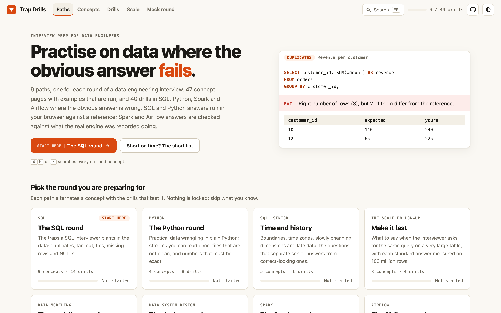
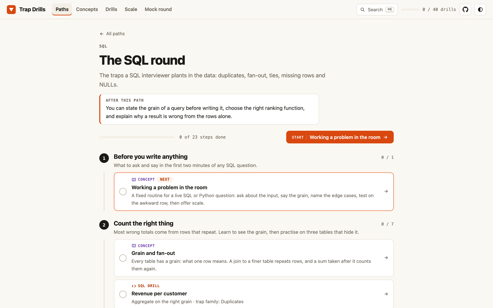
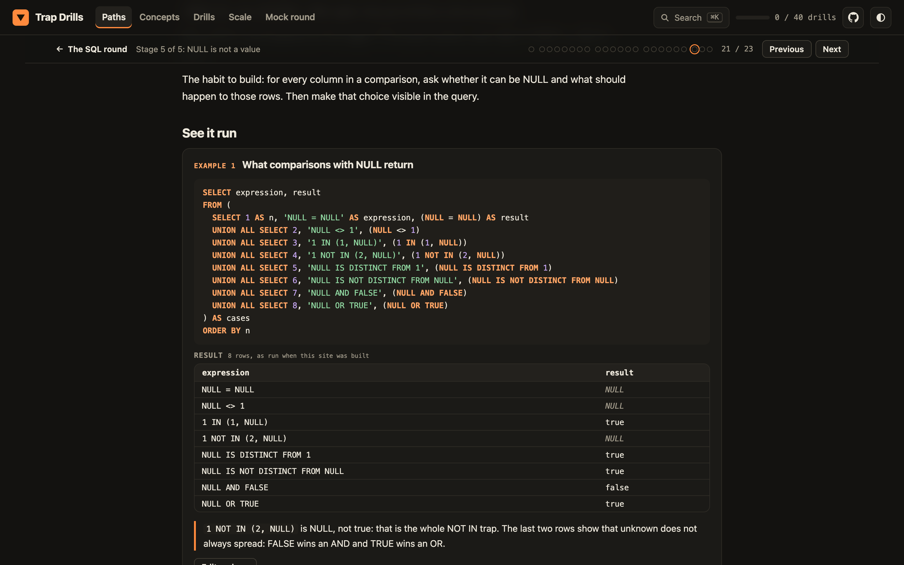
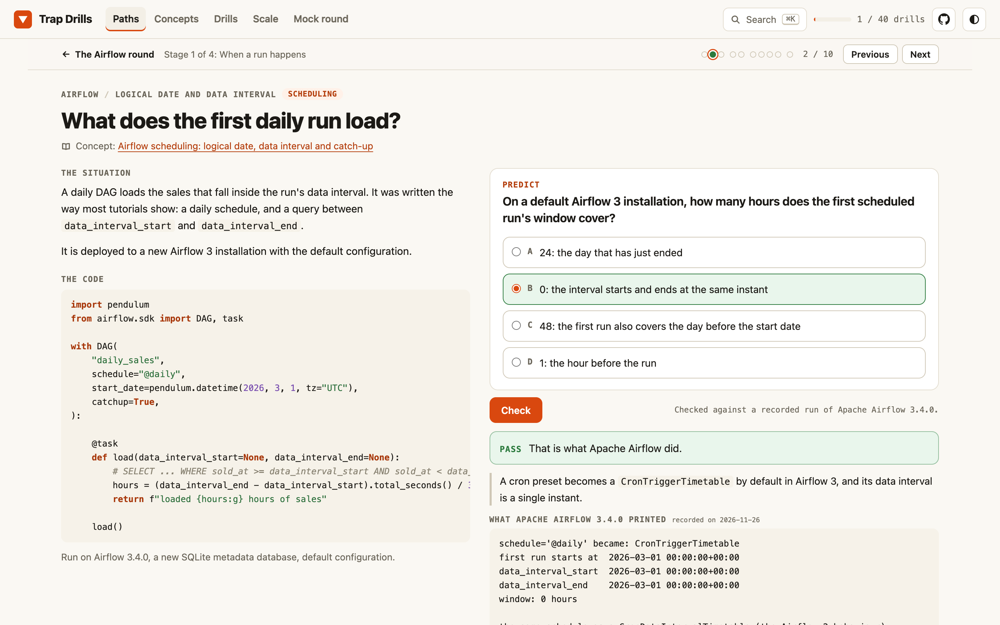
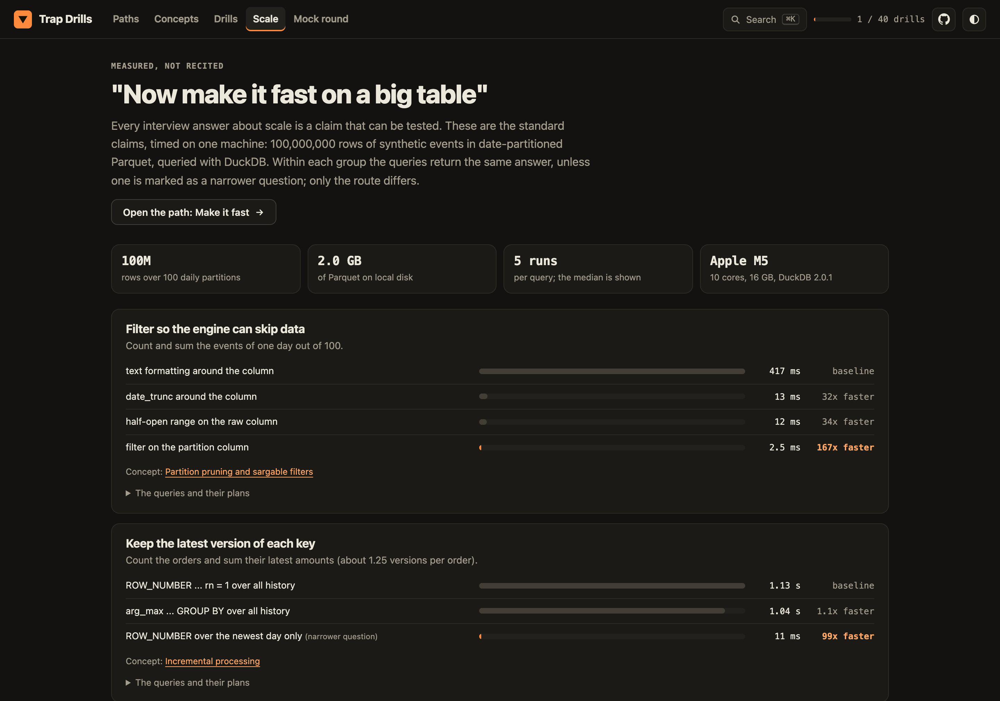

# Trap Drills

[](https://github.com/linusdominic/de-trap-drills/actions/workflows/ci.yml)

Interview prep for data engineers, built on drills where the obvious answer fails.

Each learning path covers one round of a data engineering interview and alternates a concept page with the drills that test it. A drill gives you a small dataset with a trap planted in it: a resent row, a NULL, a missing day, a tie, a time zone. You write the SQL or the Python, the checker runs it next to a reference answer, and you see exactly which rows came out wrong. There are 18 SQL, 8 Python, 9 Spark and 5 Airflow drills. A SQL or Python answer is run, in the browser or on the command line. A Spark or Airflow drill shows a piece of code and asks you to predict what it does, and its answer key is a recorded run of the real engine.

**[Open it in your browser](https://linusdominic.github.io/de-trap-drills/)**. There is nothing to install, and nothing you type leaves the page.



## The paths

<!-- paths:start -->
9 paths, 47 concept pages (24 core and 23 advanced) with 45 examples that are run, and 40 drills.

| Path | Round | Concepts | Drills | What it covers |
| --- | --- | ---: | ---: | --- |
| [The SQL round](paths/01-sql-round.toml) | SQL | 9 | 14 | The traps a SQL interviewer plants in the data: duplicates, fan-out, ties, missing rows and NULLs. |
| [The Python round](paths/02-python-round.toml) | Python | 4 | 8 | Practical data wrangling in plain Python: streams you can read once, files that are not clean, and numbers that must be exact. |
| [Time and history](paths/03-time-and-history.toml) | SQL, senior | 5 | 6 | Boundaries, time zones, slowly changing dimensions and late data: the questions that separate senior answers from correct-looking ones. |
| [Make it fast](paths/04-make-it-fast.toml) | The scale follow-up | 8 | 4 | What to say when the interviewer asks for the same query on a very large table, with each standard answer measured on 100 million rows. |
| [The modeling round](paths/05-modeling-round.toml) | Data modeling | 5 | 5 | From a product description to fact and dimension tables: grain first, then measures, then how history is kept. |
| [The design round](paths/06-design-round.toml) | Data system design | 10 | 5 | A vague prompt and 45 minutes. The concepts an interviewer probes, with drills for the parts that can be written as code. |
| [The Spark round](paths/07-spark-round.toml) | Spark | 6 | 9 | Predict what Spark does with a piece of code: how often it runs, how many partitions, which join, what reaches the scan. Every answer was recorded from a real run. |
| [The Airflow round](paths/08-airflow-round.toml) | Airflow | 5 | 5 | Predict what Airflow does with a DAG: when it runs, what window it covers, what a rerun writes, which tasks are skipped. Every answer was recorded from a real run. |
| [The short list](paths/09-short-list.toml) | Short on time | 2 | 8 | Eight drills that cover the traps asked most often, for when the interview is this week. |
<!-- paths:end -->

Nothing is locked, and the same concept or drill can sit on more than one path. Progress is kept in your browser.



## What a path is made of

**Concept pages.** One idea per page: the explanation, one or two examples on a small dataset with the output they really returned, the ways an interviewer asks about it, what a strong answer covers, and follow-up questions to answer out loud before you open them. SQL examples can be edited and run in place. The advanced pages cover what a senior loop probes: partition pruning, incremental processing, pre-aggregation, sort order, joins and skew, idempotency and backfills, delivery guarantees, change data capture, schema evolution, late data and table formats.



**Spark and Airflow drills.** The code on one side, a question and four options on the other. A wrong option tells you why it is wrong. The right one shows what the engine printed when the code was run.



**SQL and Python drills.** The brief and the data on one side, an editor on the other. A failed check lists the rows that are missing and the rows that should not be there. Three hints open one at a time, weakest first: the trap family, the trap, the reference answer. A pass opens the debrief: the trap in words, and what to answer when asked to make it fast on a very large table.


**Mock round.** Two or three drills you have not solved, a timer, and no hints. A failed check only says that it failed. The debrief comes when you finish. The Spark and Airflow round is five predictions with one attempt each.

**Search.** `Ctrl` or `Cmd` + `K` finds any path, concept or drill.

## Why

Most SQL practice checks your query against clean data, so `SUM(amount)` passes whether or not you thought about duplicates. Production tables are not clean, and neither are the datasets a good interviewer brings.

Every drill here ships with a *naive* answer, the one most people write first, and the test suite proves that it fails on the drill's data. The explanation that follows says why, and what to answer when the interviewer asks you to make it fast on a very large table.

## The traps

| Family | What goes wrong | Drills |
| --- | --- | --- |
| Duplicates | The table has more rows than the thing you are counting. | `dedupe-latest`, `sum-after-dedupe`, `login-streaks-duplicates` |
| Ties | Two rows share the value you rank by. | `top-n-ties`, `second-highest-ties` |
| Missing rows | A day, a month or a group has no rows, and the query quietly skips it. | `rolling-7d-missing-days`, `mom-growth-missing-month`, `cohort-retention-where-filter` |
| NULLs | A comparison with NULL is neither true nor false. | `not-in-null`, `reconcile-null-and-missing` |
| Grain | Rows are multiplied or mis-weighted before they are aggregated. | `fanout-join-sum`, `avg-of-averages` |
| Time | Boundaries, time zones and the order of events. | `sessionize-datediff`, `consecutive-months-year-boundary`, `funnel-event-order`, `local-day-boundary`, `between-timestamp-end`, `tumbling-windows-timezones` |
| History | The value that is true now is not the value that was true then. | `scd2-as-of-join`, `scd2-load-null-change` |
| Messy input | The file is not as clean as the example in the spec. | `flatten-json`, `slowest-endpoints-p95`, `reconcile-float-money`, `csv-quoted-commas` |
| Streams | The input is read once, arrives out of order, or never ends. | `latest-by-key-late-arrival`, `merge-sorted-streams` |
| Laziness (Spark) | Nothing runs until an action asks for it, and then everything runs again. | `lazy-recompute` |
| Partitions (Spark) | The number of tasks, and which rows share one, is not what the code suggests. | `coalesce-cannot-increase`, `coalesce-pulls-upstream`, `shuffle-partitions-aqe`, `window-single-partition`, `hot-key-partition` |
| Plans (Spark) | The optimizer decided something you cannot see in the code. | `broadcast-join-no-shuffle`, `udf-blocks-pushdown` |
| Columns (Spark) | Columns are matched by position, not by name. | `union-by-position` |
| Scheduling (Airflow) | When a run happens and what period it covers depend on the version and its defaults. | `daily-run-window`, `catchup-default` |
| Reruns (Airflow) | The task does something different the second time it runs. | `now-in-task` |
| Parsing (Airflow) | The DAG file is ordinary Python, and it is imported again and again. | `top-level-code` |
| Dependencies (Airflow) | A skipped task changes what the tasks after it do. | `branch-then-join` |

## Use it

### In the browser

Open the [site](https://linusdominic.github.io/de-trap-drills/) and pick the round you are preparing for, or the short list if the interview is this week. SQL runs in DuckDB-Wasm and Python in Pyodide, both downloaded from jsDelivr the first time you press Check. Progress and drafts are kept in your browser's local storage.

### On your machine

You need [uv](https://docs.astral.sh/uv/). It installs Python 3.12 and DuckDB for you.

```bash
git clone https://github.com/linusdominic/de-trap-drills
cd de-trap-drills
uv sync
uv run drills paths                     # the nine paths
uv run drills path sql-round            # its stages and steps
uv run drills concept grain-and-fanout  # read a concept, with its examples run
uv run drills show sum-after-dedupe     # a drill: the prompt and the data
uv run drills start sum-after-dedupe    # creates answers/sum-after-dedupe.sql
uv run drills check sum-after-dedupe    # runs it
```

A failed check looks like this:

```text
FAIL  Right number of rows (3), but 2 of them differ from the reference.
Missing from your result (2 rows, expected but not returned):
  customer_id  revenue
  -----------  -------
  10           140
  12           65
Not expected (2 rows, returned but wrong):
  customer_id  revenue
  -----------  -------
  10           240
  12           225

Stuck? drills check sum-after-dedupe --trap
```

Python answers run as ordinary Python on your machine, in a separate process with a 5-second limit. There is no sandbox, so only check code you wrote.

### With a coach

[CLAUDE.md](CLAUDE.md) turns a coding agent into a mock interviewer. Open the repository in the agent and say "take me through the SQL round" or "quiz me on SQL". It follows a path, waits for your answer, runs `drills check`, withholds the trap until you have tried, and then asks the scale follow-up and the concept's follow-up questions.

For behavioural practice, copy [profile.example.md](profile.example.md) to `private/profile.md` and fill it in. `private/` and `answers/` are git-ignored.

## How an answer is checked

- **SQL.** Your query and the reference query each run on a fresh in-memory DuckDB loaded with the drill's data. The two results are compared as sets of rows, or in order when the drill asks for an order. Numbers are compared after rounding to 6 decimal places, so `130` and `130.0` match. Column names are not checked; column count and order are.
- **Python.** Your function and the reference function are called on each case, and their results are compared as JSON. Some cases pass an iterator instead of a list, and one passes a stream that never ends.
- **Spark and Airflow.** Neither engine can run in a browser, so these drills ask for a prediction: a partition count, a join strategy, when a run happens, which tasks are skipped. The answer key is not written by hand. Each drill file holds the code you see and a few lines that inspect the result; `make engines` runs both on real PySpark and real Airflow, stores what was printed in `results/spark.json` and `results/airflow.json`, and takes the correct option from that run. The tests fail if a drill's code changes after its run, or if no option matches what the engine did.
- **Same rules on both sides.** The browser and the command line use the same normalising SQL and the same Python runner source. `make browser-check` runs every reference and naive answer in headless Chrome and fails if a single row or verdict differs from the command line.

- **Concept examples.** Every example on a concept page is run when the site is built, and the page shows what came back. `make browser-check` also runs each SQL example in the browser and compares the rows.

The Spark and Airflow answer keys in this copy:

<!-- engines:start -->
- **Spark:** 9 drills recorded on 2026-11-26 with PySpark 4.3.0, master local[4], default settings unless the code changes one (Python 3.12.16, openjdk version "21.0.13.0.2" 2026-10-22).
- **Airflow:** 5 drills recorded on 2026-11-26 with Airflow 3.4.0, a new SQLite metadata database, default configuration (Python 3.12.16).
<!-- engines:end -->

A drill is one TOML file: prompt, setup SQL or test cases, naive answer, reference answer, explanation. See [drills/sql/11-not-in-null.toml](drills/sql/11-not-in-null.toml) for a short one. To add a drill, copy a file, change it and run `uv run drills verify`: the reference must pass and the naive answer must fail. A concept ([concepts/](concepts/)) and a path ([paths/](paths/)) are TOML files too; the tests require every drill to be explained by a concept and to sit on a path after it.

## The scale follow-up, measured

Every senior SQL question ends with "now make it fast on 10 billion rows", and the standard answers are usually recited, not tested. [tools/scale_bench.py](tools/scale_bench.py) tests five of them on one machine. The variants in each group return the same answer unless marked.

<!-- scale:start -->
Run on 2026-11-26: 100,000,000 rows over 100 daily partitions (2.0 GB of Parquet), DuckDB 2.0.1, Apple M5, 10 cores, 16 GB. Median of 5 runs.

| Question | Query | Median | Against the first |
| --- | --- | ---: | --- |
| Count and sum the events of one day out of 100. | text formatting around the column | 417 ms | baseline |
|  | date_trunc around the column | 13 ms | 32x faster |
|  | half-open range on the raw column | 12 ms | 34x faster |
|  | filter on the partition column | 2.5 ms | 167x faster |
| Count the orders and sum their latest amounts (about 1.25 versions per order). | ROW_NUMBER ... rn = 1 over all history | 1.13 s | baseline |
|  | arg_max ... GROUP BY over all history | 1.04 s | 1.1x faster |
|  | ROW_NUMBER over the newest day only (a narrower question) | 11 ms | 99x faster |
| Revenue per user segment: events joined to a 2,000,000-row user table. | join, then aggregate | 421 ms | baseline |
|  | aggregate per user, then join | 545 ms | 1.3x slower |
| Revenue per day and city for the last 30 days. | from the raw events | 35 ms | baseline |
|  | from a daily summary table | 1.2 ms | 29x faster |
| Count and sum the events of a single user. | files ordered by time | 34 ms | baseline |
|  | a copy sorted by user_id | 9.4 ms | 3.6x faster |
<!-- scale:end -->

Three results differ from the textbook, which is the reason to measure:

- **A function around the filter column is not always a full scan.** `strftime(ts, ...) = '2026-02-19'` read every row. `date_trunc('day', ts) = ...` did not: the plan shows DuckDB pushed a plain range on `ts` into the scan, and it cost the same as writing the range by hand.
- **`ROW_NUMBER() ... rn = 1` and `arg_max ... GROUP BY` are the same query here.** Both plans contain a hash aggregate and no window operator. The real saving is to deduplicate only the newest partition.
- **Aggregating before the join was slower.** With a 2-million-row dimension, the join is cheap and the extra per-user aggregate is not. The usual advice is about cutting shuffled rows on a cluster, which a single machine does not have.

The queries, all five timings per query and each plan's operators are in [results/scale.json](results/scale.json). Reproduce with `make scale` (about 4 GB of scratch disk, deleted afterwards).



## The field guide

The concept pages are the structured version of these notes. [guide/README.md](guide/README.md) is the long form, for the rounds the drills do not cover by themselves: data modeling (a six-step approach and a worked example), data system design (a 45-minute framework, a table of concepts and three worked designs), Spark and warehouse questions, and operations. Each SQL pattern and trap in it links to the drill that exercises it.

## What was verified

On macOS, on 26 November 2026, unless stated.

- `uv run drills verify`: for all 40 drills, the reference answer (for Spark and Airflow, the recorded value) passes and the naive answer fails, and every concept example runs and returns something.
- `make engines`: all 9 Spark drills ran on PySpark 4.3.0 with Java 21 and all 5 Airflow drills on Airflow 3.4.0. Their answer keys are those runs. Two of the Airflow answers follow from defaults that changed in Airflow 3 (a cron preset gives a run whose data interval is empty, and catch-up is off).
- All 18 SQL reference answers parse with PostgreSQL's parser (pglast 8.9).
- The site was opened in a Chromium browser at desktop width and at 375 px, in light and dark. Exercised by hand: a path page, a failed check, the three hints, a passed check with its debrief, a concept page with an edited example, search, and one mock round to its result page.
- `make check`: ruff, mypy in strict mode and 297 tests pass. They have not run in GitHub Actions for this version yet.

The browser against the command line (`make browser-check`):

<!-- browser:start -->
On 2026-11-26, 40 of 40 drills gave the same result rows, the same case outputs and the same verdicts in Google Chrome 158.0.8127.38 (DuckDB-Wasm 1.32.0, which is DuckDB v1.4.3; Pyodide 314.0.8, which is Python 3.14.2) and on the command line (DuckDB 2.0.1, Python 3.12.16). 14 of those are Spark and Airflow drills, which run no engine in the browser: for them the comparison covers the answer key and the verdicts. 35 of 35 SQL examples on the concept pages returned the same rows in both.
<!-- browser:end -->

## What was not verified

- **The live site, for this version.** The published site was last checked before the paths and concept pages were added.
- **Other browsers.** Only Chrome 158 was used. Firefox, Safari and real phones are untested, and nobody has tried typing a query on a phone keyboard.
- **The CDN.** The site needs jsDelivr for DuckDB-Wasm (a 34 MB file, about 5 MB compressed in transit) and Pyodide (about 6 MB in transit). Offline, or where that host is blocked, the drills do not run in the browser. Load time on a slow connection was not measured.
- **Engine versions.** The browser runs DuckDB 1.4.3 and the command line runs 2.0.1. They agree on the 52 answers that ship with the drills; a query you write can still behave differently in the two.
- **A PASS is not a proof.** Your answer matched the reference on one small dataset. A query that is wrong in general can still pass.
- **Spark beyond one laptop.** The Spark drills ran in local mode with 4 cores on one version. A cluster, Spark 3, and vendor runtimes such as Databricks were not run; where a text says what an older version does, that is from experience.
- **Airflow beyond one version.** The Airflow drills ran on 3.4.0 with SQLite, using the scheduler's timetable code under a frozen clock, the DAG parser, and `airflow dags test`. No scheduler was left running to create the runs, and Airflow 2 itself was not run: its behaviour is shown through `CronDataIntervalTimetable` on 3.4.
- **Other SQL engines.** The reference answers parse as PostgreSQL but were not run on PostgreSQL, Redshift, Snowflake, BigQuery or Spark.
- **The scale numbers.** One machine, one engine, a warm file cache and uniform synthetic data. They show the mechanism and say nothing about a cluster. They were not repeated on a second machine.
- **The concept pages and the field guide.** Their examples are run; their prose is not tested. Statements about specific engines (Spark, Snowflake, BigQuery, Redshift, PostgreSQL, Kafka, Iceberg, Delta) were written from experience and not checked against current documentation.
- **The paths as teaching.** The order of the steps, the choice of what is core and what is advanced, and the mock round's lengths are editorial choices. Nobody but the author has worked through a path, so there is no evidence yet that it prepares anyone better than another route.
- **Accessibility.** Keyboard use was tried (search, the editor's Esc then Tab exit); no screen reader was used.
- **Coach mode.** The instructions have not been through a full mock session.
- **Windows.** Not tried.

## Development

```bash
make setup           # uv sync
make check           # ruff, mypy, tests, drills verify, generated files up to date
make site            # rebuild docs/drills.json and the README's generated blocks
make serve           # the site at http://127.0.0.1:8791
make browser-check   # every drill in headless Chrome against the command line
make scale           # re-run the benchmark
make engines         # re-run the Spark and Airflow drills on the real engines (needs Java 17 or 21)
```

The site is static: `docs/index.html`, `docs/app.js` (the pages), `docs/engine.js` (DuckDB-Wasm, Pyodide and the checking rules), `docs/editor.js` (the code editor), `docs/styles.css`, `docs/py-worker.js` and the generated `docs/drills.json`. There is no build step and no server.

## License

MIT. See [LICENSE](LICENSE).
